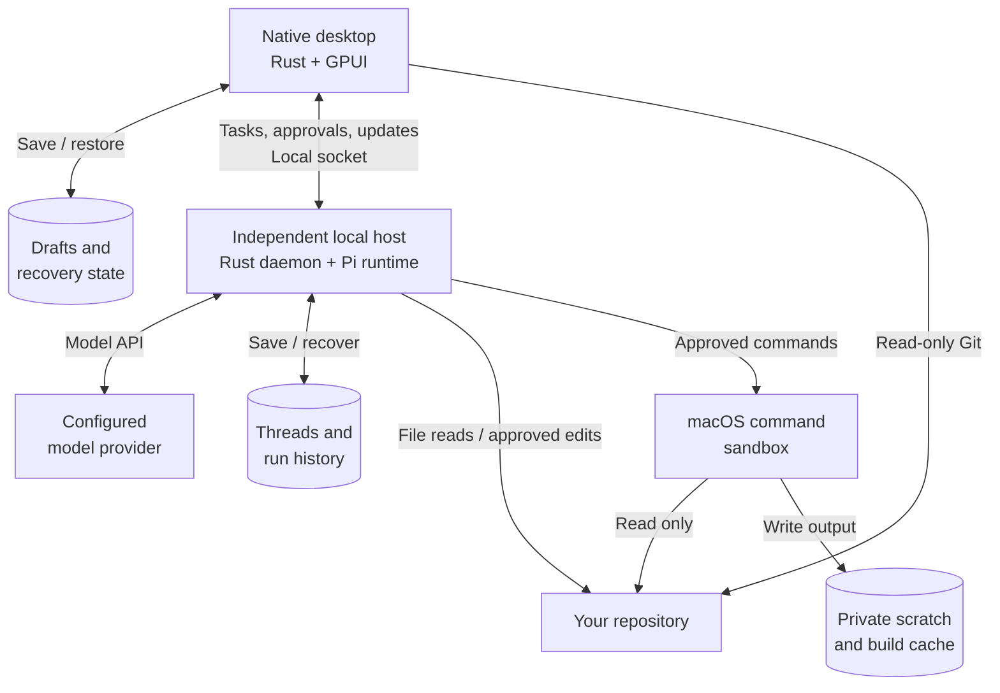

# Plait

**A native macOS app for working with AI coding agents.**

Open a repository, start a conversation, approve edits and commands, and review
what changed. An independent host runs the agent, so closing the desktop does
not stop accepted work. Reopen it to return to the same thread and saved draft.

[Download preview](https://github.com/heath0xFF/plait/releases/tag/v0.1.0-preview.2) · [Documentation](docs/README.md) · [Contribute](CONTRIBUTING.md)


*Installed Mac app. Scripted provider; real approved source edits and Cargo tests.*

## Install

The preview targets **Apple Silicon and macOS 15 or later**. You need Git and
your own model-provider account. The installer includes the host and Node runtime.

**This preview is unsigned and not notarized.** Review the
[Mac setup guide](docs/MACOS.md) before installing. Do not disable Gatekeeper.

[Download the DMG](https://github.com/heath0xFF/plait/releases/download/v0.1.0-preview.2/Plait-0.1.0-5316950cf690-macos-arm64.dmg),
open it, and run **Install Plait.pkg**. Or install from Terminal:

```sh
curl --proto '=https' -fsSL \
  https://github.com/heath0xFF/plait/releases/download/v0.1.0-preview.2/install.sh |
  bash -s -- --version v0.1.0-preview.2 --allow-unsigned
```

Run as your normal user. The script requests administrator access for package
installation and verifies SHA-256 checksums, not publisher signatures.
Later releases install from **Plait → Check for Updates…** once Plait is a
per-user install. See [updates](docs/MACOS.md#updates); package installs move
over once with `scripts/update-installed-macos.sh`.

## Start working

1. Open **Plait** and choose **Open repository…** (Cmd-O).
2. Open **Settings** (Cmd-comma) and select an authenticated model.
   [Set up Pi authentication](docs/MACOS.md#authentication-and-status) if needed.
3. Start a thread. Review each edit and command before **Allow once**.
4. Read the results, inspect **Changes**, and continue in the same conversation.
   Use **Stop** to cancel work; closing the desktop is not Stop.

Code blocks, tool details, and message text have copy controls. Threads and drafts
restore on reopening; no task is sent automatically. See
[keyboard controls](docs/MACOS.md#keyboard-controls) and
[Build Plait with Plait](docs/SELF-HOSTING.md) for the edit → test → review loop.

Source builds with a version 3 host also queue follow-ups and steering while an
agent works, and let you change a thread's model and thinking level between
runs. The composer shows waiting inputs and the latest context usage. See
[working during a run](docs/MACOS.md#working-during-a-run).

## How it works

The desktop and execution host run on your Mac. The desktop is a client;
the independent host owns accepted work and its history.



In v0.1.0-preview.2, each file change and command needs **Allow once**. Source
builds after it run edits and commands without asking by default; choose
**Ask each time** under Settings → Approvals to restore prompts. In both modes,
files you had already changed are protected, and sandboxed commands cannot
write the checkout or use external networking. The desktop never receives
provider credentials. Closing it does not stop accepted work; pending approvals
still wait for you.

## Current limits

This is the **M2 local preview**, not a complete IDE.

- Local macOS execution only. Remote hosts and Linux execution are not available.
- Git views are read-only. Use your own tools for staging and commits. There is
  no file editor, embedded terminal, mandatory worktree, or automatic updater.
- Commands cannot use external networking or write the checkout. Approved file
  tools make edits; build output goes to private caches. Model requests need
  access to your configured provider. Source builds of the host after
  v0.1.0-preview.2 also have an opt-in, per-project
  [trusted command mode](docs/HOST.md#command-policy) that lifts these limits;
  no desktop control sets it yet.
- Conversation and tool views show bounded previews, not the full stored history.

Mac CI verifies the installed app, sandbox, and recovery with scripted providers.
Installed live-model and accessibility acceptance remain open. CI runs on macOS 26;
older-system runtime coverage and other open checks are in
[Verification](docs/VERIFICATION.md). Planned features are in the [roadmap](docs/ROADMAP.md).

## Development

The desktop is **Rust + GPUI**, the host is **Rust**, and the agent runtime is a
**Pi Durable TypeScript sidecar**. Application code and design are original;
declared dependencies stay pinned and retain their licenses.

Start with [Contributing](CONTRIBUTING.md) for build requirements and checks.
[Architecture](docs/ARCHITECTURE.md), [host and sandbox rules](docs/HOST.md), and
[design principles](DESIGN.md) describe the implementation boundaries.

## License

Plait's original code and documentation are [MIT licensed](LICENSE).
Dependencies retain their own licenses, including GPUI's Apache-2.0 license.
