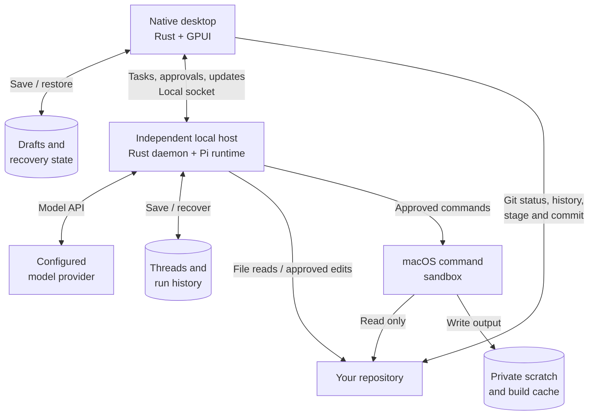

# Plait

**A native macOS app for working with AI coding agents.**

Open a repository, start a conversation, approve edits and commands, and review
what changed. An independent host runs the agent, so closing the desktop does
not stop accepted work. Reopen it to return to the same thread and saved draft.

[Download preview](https://github.com/heath0xFF/plait/releases) · [Documentation](docs/README.md) · [Contribute](CONTRIBUTING.md)


*Installed Mac app. Scripted provider; real approved source edits and Cargo tests.*

## Install

The preview targets **Apple Silicon and macOS 15 or later**. You need Git and
your own model-provider account. The installer includes the host and Node runtime.

**This preview is unsigned and not notarized.** Review the
[Mac setup guide](docs/MACOS.md) before installing. Do not disable Gatekeeper.

Download the **DMG** from the [releases page](https://github.com/heath0xFF/plait/releases),
open it, and run **Install Plait.command**. Or install from Terminal:

```sh
curl --proto '=https' -fsSL \
  https://raw.githubusercontent.com/heath0xFF/plait/main/scripts/install.sh |
  bash -s -- --allow-unsigned
```

This installs the prebuilt app and bundled host. You do not need a source
checkout, Xcode, Rust, or Node. Finish active tasks first; threads, drafts, and
credentials are preserved. An older system-wide install needs administrator
access once to move to the per-user layout. Initial downloads are checked
against SHA-256 metadata over HTTPS; the flag accepts the unsigned preview.

Future updates install from **Plait → Check for Updates…**, using signed release
manifests. See [Mac setup and updates](docs/MACOS.md).

## Start working

1. Open **Plait** and choose **Open repository…** (Cmd-O).
2. Open **Settings** (Cmd-comma) and select an authenticated model. Current builds
   offer **Providers** for sign-in, API keys, and custom servers; see
   [authentication setup](docs/MACOS.md#authentication-and-status) for the preview.
3. Start a thread. Review each edit and command before **Allow once**.
4. Read the results, review and commit them in **Changes**, and continue in the
   same conversation. **History** shows earlier commits.
   Use **Stop** to cancel work; closing the desktop is not Stop.

Current builds show projects across checkouts, live
thread status, unread activity, search, rename, and archive. Opening another
project keeps each thread's draft. See [project navigation](docs/MACOS.md#projects-and-threads)
for live-list limits and notifications.

Code blocks, tool details, and message text have copy controls. Threads and drafts
restore on reopening; no task is sent automatically. Drag either side panel's
edge to resize it; Cmd-B and Cmd-L hide the sidebar and Git inspector. See
[keyboard controls](docs/MACOS.md#keyboard-controls) and
[Build Plait with Plait](docs/SELF-HOSTING.md) for the edit → test → review loop.

Current builds with a version 3 host queue follow-ups and steering while an
agent works, and let you change a thread's model and thinking level between
runs. The composer shows waiting inputs and the latest context usage, and its
run-settings menu sets the thread's approval mode. See
[working during a run](docs/MACOS.md#working-during-a-run).

## How it works

The desktop and execution host run on your Mac. The desktop is a client;
the independent host owns accepted work and its history.



Current builds run edits and commands without asking by default; choose
**Ask each time** under Settings → Approvals to restore prompts, or choose for
one thread from the run settings under its message box. In both modes,
files you had already changed are protected, and sandboxed commands cannot
write the checkout or use external networking. The desktop never receives
provider credentials. Closing it does not stop accepted work; pending approvals
still wait for you.

## Current limits

This is the **M2 local preview**, not a complete IDE.

- Local macOS execution only. Remote hosts and Linux execution are not available.
- Changes stages and discards (by file or hunk, with undo), commits, fetches,
  pushes, and fast-forward pulls; History shows commits and their patches.
  **New Thread in Worktree** (Cmd-Option-N) starts a thread on a new branch in
  its own worktree beside the repository, listed under the same project;
  the thread's menu removes it once its work is committed. Worktrees are never
  required. There is no merge, rebase, branch switching, file editor, or
  embedded terminal. Updates are
  installed explicitly; they never restart active work automatically.
- Sandboxed commands cannot use external networking or write the checkout.
  Approved file tools make edits; build output goes to private caches. The
  opt-in, per-project [trusted command mode](docs/HOST.md#command-policy) lifts
  these limits. Settings → Approvals explains the scope before confirmation.
- With a version 3 host, complete stored messages and tools load on demand,
  including earlier history and reasoning. A response still being generated
  remains a live preview until saved; exceptionally large stored fields have
  explicit text-part controls.

Mac CI verifies the installed app, sandbox, and recovery with scripted providers.
A live-model self-development cycle has also been exercised; broader provider
and accessibility acceptance remain open. CI runs on macOS 26;
older-system runtime coverage and other open checks are in
[Verification](docs/VERIFICATION.md). Planned features are in the [roadmap](docs/ROADMAP.md).

## Development

The desktop is **Rust + GPUI**, the host is **Rust**, and the agent runtime is a
**Pi Durable TypeScript sidecar**. Application code and design are original;
declared dependencies stay pinned and retain their licenses.

Start with [Contributing](CONTRIBUTING.md) for build requirements and checks.
[Architecture](docs/ARCHITECTURE.md), [host and sandbox rules](docs/HOST.md), and
[design principles](DESIGN.md) describe the implementation boundaries.

## License

Plait's original code and documentation are [MIT licensed](LICENSE).
Dependencies retain their own licenses, including GPUI's Apache-2.0 license.
