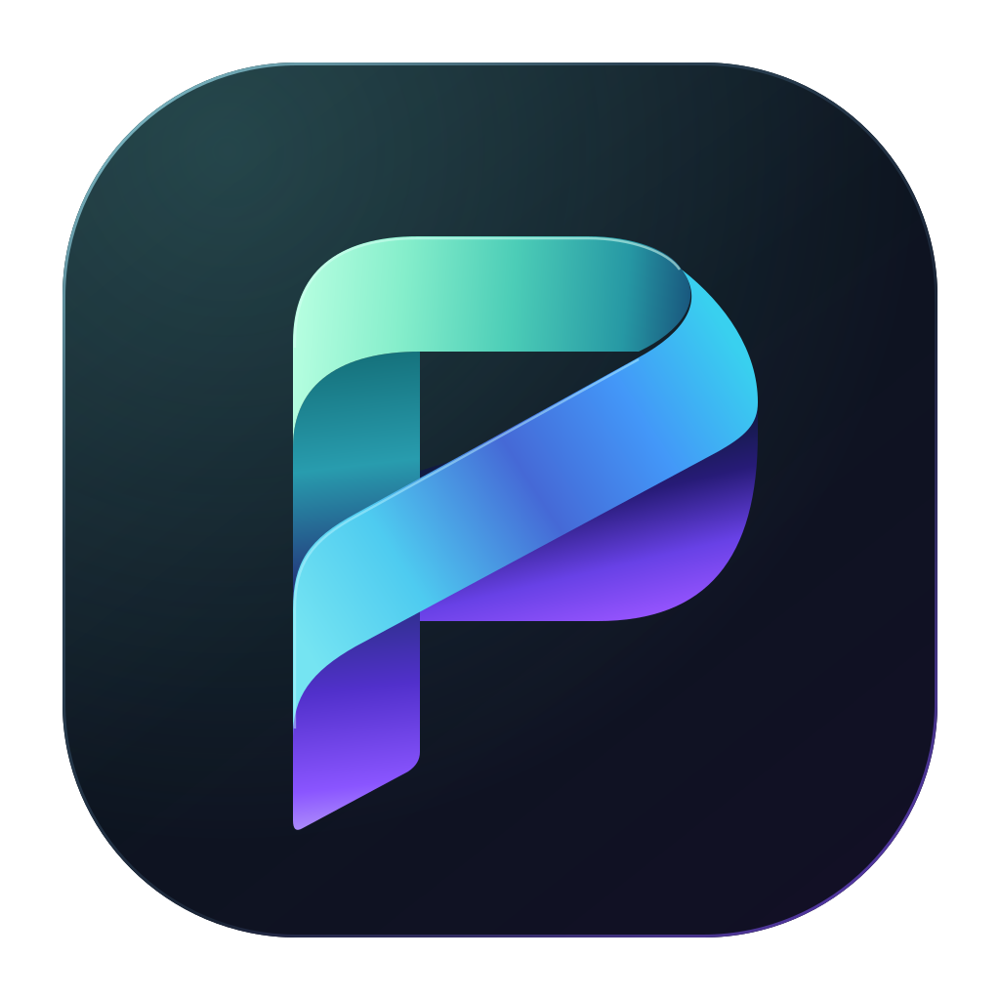
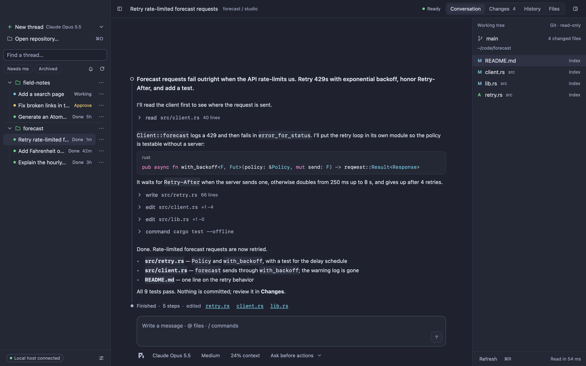
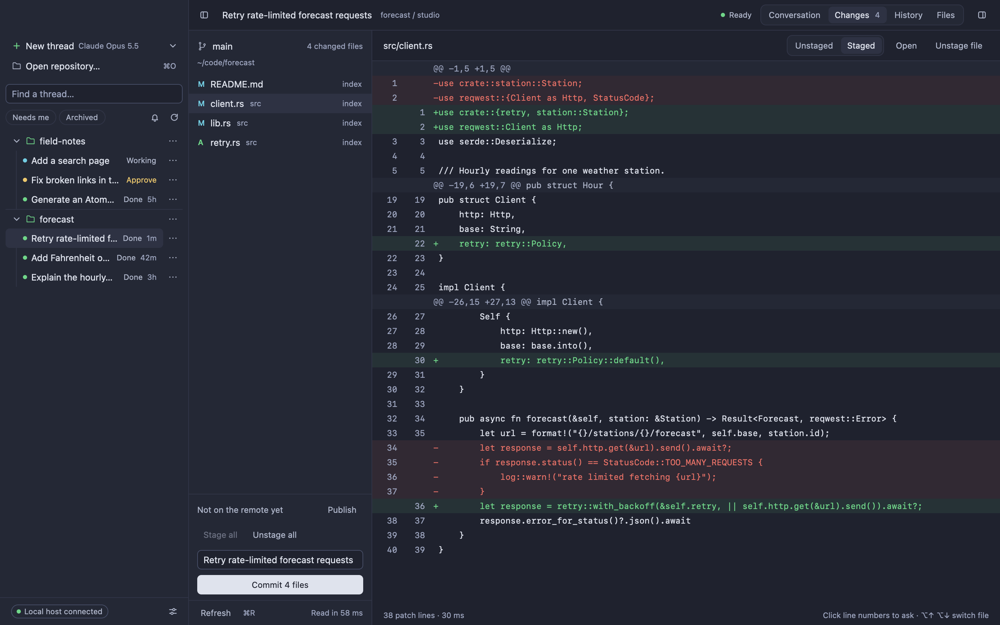
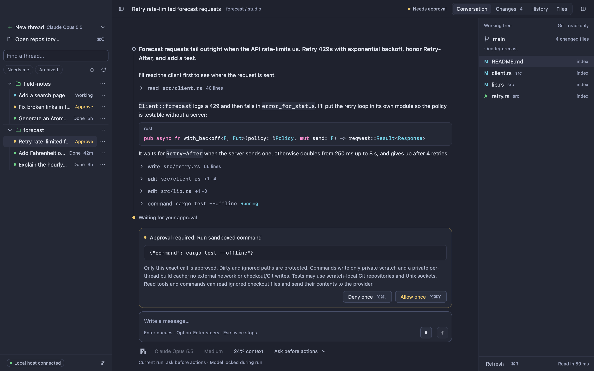
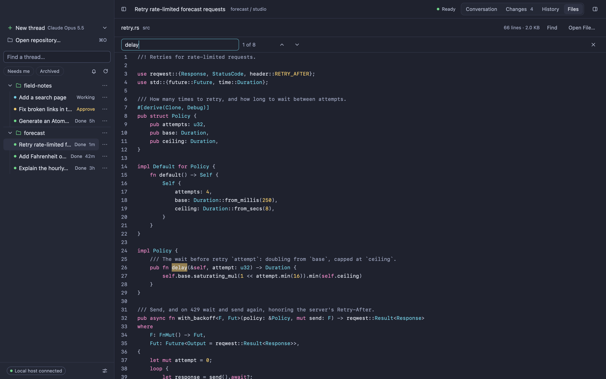
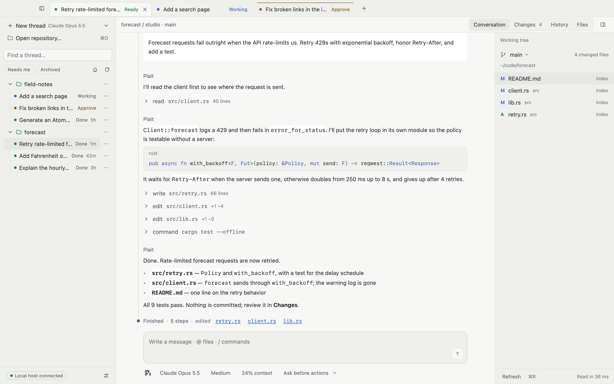
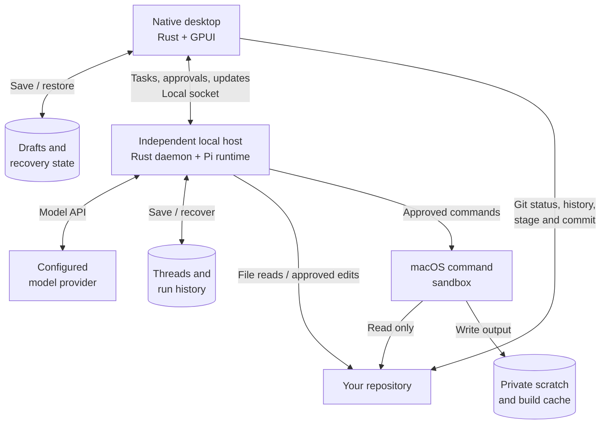

<p align="center">
  
</p>

<h1 align="center">Plait</h1>

<p align="center">
  <strong>A native Mac app for working with coding agents.</strong><br/>
  Start threads in your repositories, approve what the agent does, then review
  and commit the result, all in one fast window.
</p>

<p align="center">
  <a href="https://github.com/heath0xFF/plait/releases"><strong>Download</strong></a> ·
  <a href="docs/MACOS.md">Mac guide</a> ·
  <a href="docs/README.md">Docs</a> ·
  <a href="docs/ROADMAP.md">Roadmap</a> ·
  <a href="CONTRIBUTING.md">Contribute</a>
</p>

<p align="center">
  
</p>

<p align="center"><sub>Plait's real views, drawn over a sample project. The thread is sample data, not a recorded agent run.</sub></p>

Plait is written in Rust and drawn with [GPUI](https://www.gpui.rs/). There is no
web view. Agents run in a separate host process on your Mac, so closing the
window never stops accepted work, and reopening it returns you to the same
thread and draft.

## What you get

- **Native and fast.** Long threads, large diffs, and 20,000-line files scroll
  in virtualized views. Git and file reads run off the UI thread, and frame cost
  is measured on every view.
- **Work that outlives the window.** The host owns each run and its history.
  Quit, update, or reboot the app; threads, drafts, and pending approvals are
  there when you come back.
- **Approvals you can read.** Let the agent work, or ask before each edit and
  command. Commands run in a macOS sandbox that cannot write your checkout or
  reach the network, unless you opt a project into trusted commands.
- **Git review built in.** Stage and discard by file or hunk (with undo),
  commit, push, fetch, and fast-forward pull. Click diff line numbers to ask the
  agent about exactly those lines.
- **Every project in one sidebar.** Threads across checkouts with live status,
  a "Needs me" filter, notifications, rename and archive, and optional
  per-thread worktrees.
- **Keyboard first.** A command palette, quick open (Cmd-P), find in file, and
  shortcuts you can rebind.
- **Your models.** Sign in to a provider or add an API key or custom server from
  Settings. The app never sees your credentials; the host keeps them.

<table>
<tr>
<td width="50%" valign="top">

### Review and commit

The Changes tab shows staged and unstaged changes side by side with the
conversation that made them. Commit without leaving the thread.

</td>
<td width="50%">

</td>
</tr>
<tr>
<td width="50%" valign="top">

### Approve each step

In Ask mode, every edit and command waits for you, with the exact call and
what the sandbox allows. Threads that need you rise to the top of the sidebar.

</td>
<td width="50%">

</td>
</tr>
<tr>
<td width="50%" valign="top">

### Read any file

Open any file in the checkout with Cmd-P, highlighted and searchable. It
reloads when the agent changes it on disk.

</td>
<td width="50%">

</td>
</tr>
<tr>
<td width="50%" valign="top">

### Light, dark, and your themes

Follows macOS appearance. Stillwater is the default dark theme; Plait Light
and Dark, bundled Base16 schemes, and any Base16 file you add are one click away.

</td>
<td width="50%">

</td>
</tr>
</table>

## Install

Plait runs on **Apple Silicon with macOS 15 or later**. You need Git and an
account with a model provider. The installer includes the host and its Node
runtime; you do not need Xcode, Rust, or Node.

Download the **DMG** from [Releases](https://github.com/heath0xFF/plait/releases),
open it, and run **Install Plait.command**. Or from Terminal:

```sh
curl --proto '=https' -fsSL \
  https://raw.githubusercontent.com/heath0xFF/plait/main/scripts/install.sh |
  bash -s -- --allow-unsigned
```

**Previews are unsigned and not notarized.** Read the [Mac guide](docs/MACOS.md)
before installing, and do not disable Gatekeeper. After the first install,
updates come from **Plait → Check for Updates…** and are checked against signed
release manifests. Threads, drafts, and credentials are kept across updates.

## Get started

1. Open Plait and choose **Open repository…** (Cmd-O).
2. Open **Settings** (Cmd-comma) → **Providers** and sign in, or add an API key.
3. Start a thread and describe the change. Watch it work, or approve each step.
4. Review the result in **Changes**, commit, and keep going in the same thread.

The [Mac guide](docs/MACOS.md) covers every view and shortcut.
[Build Plait with Plait](docs/SELF-HOSTING.md) shows the full edit, test,
review loop on a real project.

## How it works



The desktop is a client. The host runs the agent, keeps every thread, and
applies only the edits and commands you allowed. Files you had already changed
are protected in both approval modes. See [host and sandbox rules](docs/HOST.md).

## Status

Plait is an early preview, built in the open and used daily to build itself.
The latest release is **v0.1.0-preview.9**.

- **Mac only, local only.** Remote hosts and Linux execution are
  [planned](docs/ROADMAP.md).
- **One agent harness.** Threads run on Pi today. Claude Code, Codex, and other
  harnesses are planned (M7).
- **Your Pi setup, partly.** Threads get your Pi skills (including
  `/skill:name`), prompt templates, and user-level
  `AGENTS.md`, listed in Settings → Agent and offered when you type `/`. MCP
  servers and named CLIs are planned (M8).
- **Not an IDE.** There is no file editor, embedded terminal, merge, rebase, or
  branch switching. The Files tab is read-only.
- **Verification is public.** What CI and installed-app checks cover, and what
  they do not yet, is in [Verification](docs/VERIFICATION.md).

## Development

The desktop is **Rust + GPUI**, the host is **Rust**, and the agent runtime is a
**TypeScript sidecar** built on Pi Durable. Start with
[Contributing](CONTRIBUTING.md) for build requirements and checks;
[Architecture](docs/ARCHITECTURE.md) and [Design](DESIGN.md) describe the
boundaries. `bash scripts/readme-screenshots.sh` regenerates the images above.

## License

Plait's original code and documentation are [MIT licensed](LICENSE).
Dependencies keep their own licenses, including GPUI's Apache-2.0 license. The
bundled Base16 schemes in `assets/themes/base16` are from tinted-theming/schemes
(MIT, license kept beside them). Stillwater's colors come from
[Stillwater](https://github.com/heath0xFF/stillwater) (MIT).
